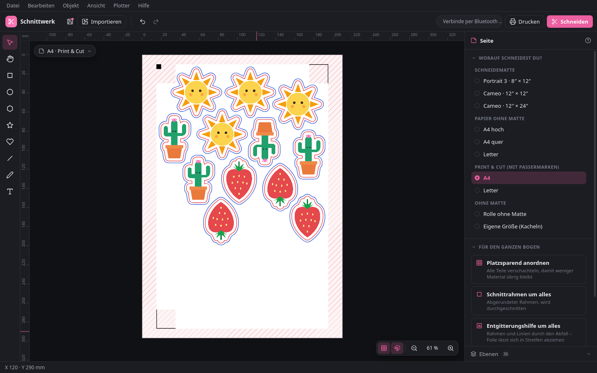
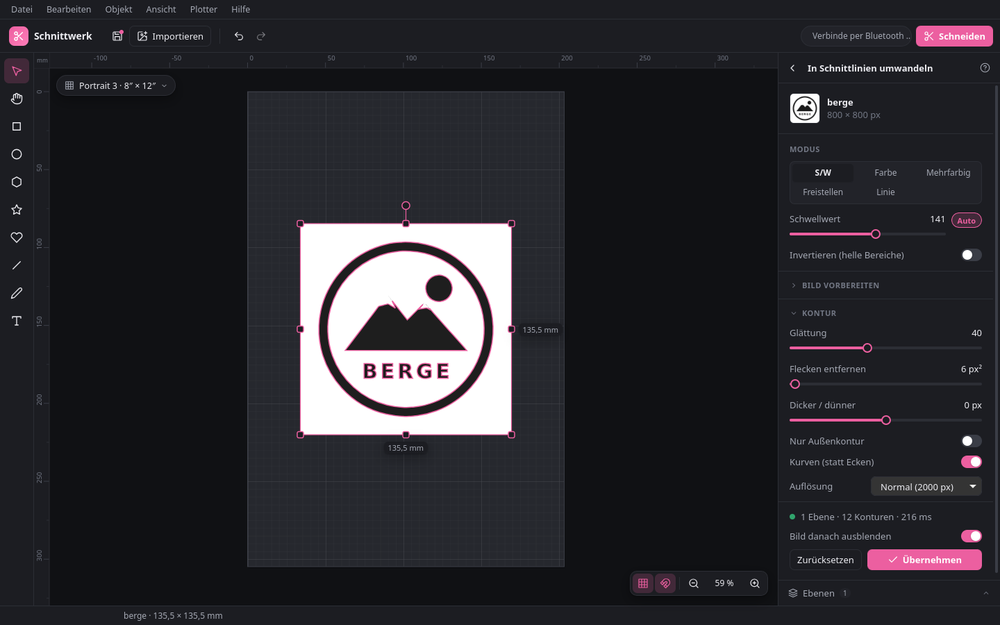
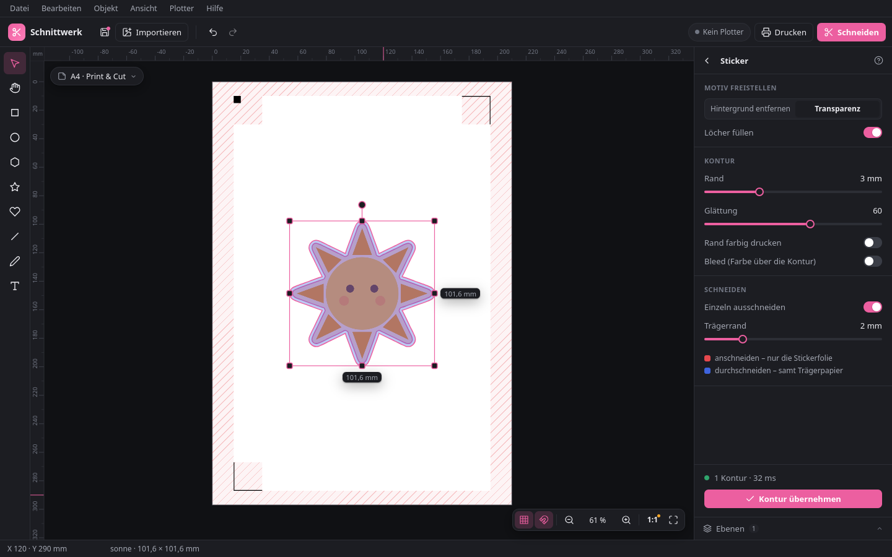
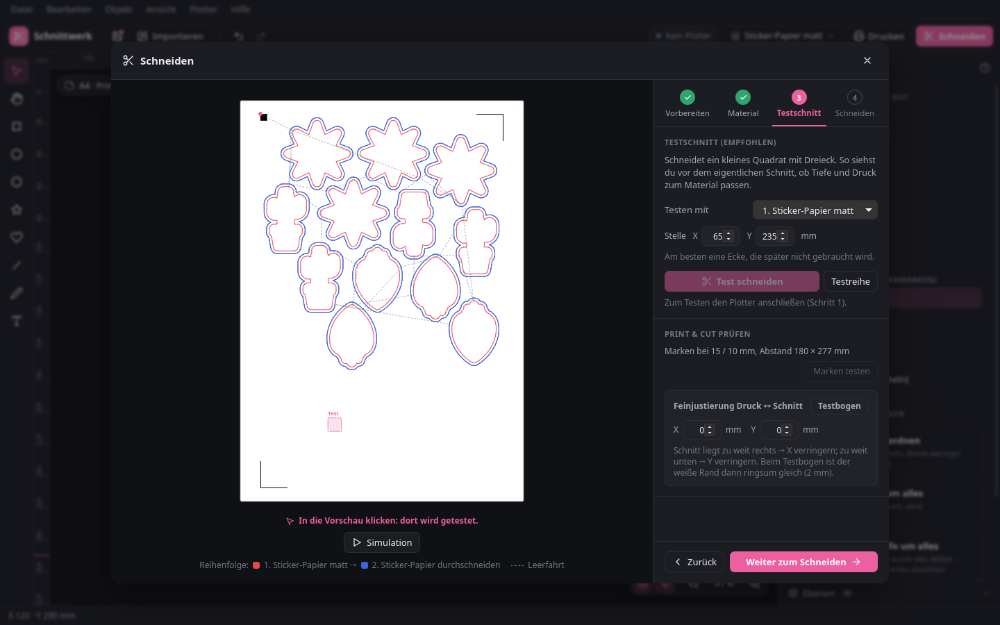

# Schnittwerk

Linux-Software für Silhouette-Schneideplotter (Ziel: **Portrait 3**). Damit kannst du
Bilder tracen, Sticker mit Print & Cut erstellen und direkt per USB schneiden. Du
brauchst dafür weder Silhouette Studio noch Windows.



> [!NOTE]
> **Von einer KI geschrieben.** Der Code und diese Anleitung wurden mit
> Claude (Anthropic) erstellt, unter Anleitung und mit Tests durch einen Menschen.
> Der Code wurde nicht unabhängig geprüft. Wer ihn für Wichtiges einsetzt, sollte
> ihn vorher selbst lesen.

> [!WARNING]
> Getestet ist bisher nur die **Portrait 3 (USB und Bluetooth)**. Die anderen
> Modelle sind eingebaut, aber noch nicht an echter Hardware erprobt
> (siehe [Unterstützte Geräte](#unterstützte-geräte)). Mach bei
> neuem Material immer erst einen Testschnitt. Die Nutzung erfolgt auf eigene
> Verantwortung (siehe [Lizenz](#lizenz)).

| Startseite | Bilder tracen | Sticker-Assistent |
|---|---|---|
|  |  |  |

| Formen, Text auf Bogen, Hilfslinien | Schneiden | Große Motive in Kacheln |
|---|---|---|
|  |  |  |

## Unterstützte Geräte

| Gerät | Eingebaut | USB | Bluetooth | An echter Hardware getestet |
|---|---|---|---|---|
| Silhouette Portrait 3 | ✅ | ✅ | ✅ | ✅ USB und Bluetooth |
| Silhouette Portrait 4 | ✅ | ✅ | ✅ | ⬜ noch nicht |
| Silhouette Cameo 4 | ✅ | ✅ | ✅ | ⬜ noch nicht |
| Silhouette Cameo 5 | ✅ | ✅ | ✅ | ⬜ noch nicht |
| Silhouette Portrait 2 | ⚠️ nur erkannt | – | – | ⬜ |
| Silhouette Portrait (1. Generation) | ⚠️ nur erkannt | – | – | ⬜ |

- **Eingebaut** heißt: Das Gerät wird erkannt und bekommt dieselben Befehle wie die
  Portrait 3 (Cameo-4-Gerätefamilie). Es sollte also funktionieren, ist aber nicht
  erprobt. Bei Bluetooth gilt das nur, wenn das Gerät Bluetooth hat.
- **Nur erkannt**: Ältere Modelle nutzen andere Befehle. Schnittwerk meldet sie,
  schneidet aber (noch) nicht mit ihnen.
- **Cameo 4 und 5**: Bisher gibt es nur die 8″ × 12″-Matte der Portrait. Breitere
  Flächen gehen über „Rolle ohne Matte“ oder „Eigene Größe“ mit Kacheln. Eine
  12″-Matte ist noch nicht eingebaut.
- Andere Hersteller (Cricut, Brother usw.) werden nicht unterstützt.

Wer ein nicht getestetes Gerät hat: Rückmeldung als
[Issue](https://github.com/FelixLenz-Code/schnittwerk/issues) hilft sehr,
gerne mit dem Ergebnis eines Testschnitts.

## Installation

Für **Ubuntu 24.04 oder neuer** und darauf aufbauende Systeme (64 Bit, x86).

1. Lade die Datei `Schnittwerk_…_amd64.deb` vom
   [neuesten Release](https://github.com/FelixLenz-Code/schnittwerk/releases/latest) herunter.
2. Öffne ein Terminal im Download-Ordner und installiere sie:
   ```bash
   sudo apt install ./Schnittwerk_*_amd64.deb
   ```
   `apt` installiert dabei die benötigten Pakete mit (libusb, CUPS-Client, poppler-utils).
3. **Stecke den Plotter einmal aus und wieder ein.** Das Paket bringt eine udev-Regel
   mit, damit Schnittwerk ohne Administratorrechte auf den Plotter zugreifen darf.
   Diese Regel greift erst nach dem Neueinstecken.
4. Starte **Schnittwerk** über das Anwendungsmenü.

Ein Update installierst du genauso: neue `.deb` herunterladen und `sudo apt install` erneut ausführen.
Zum Entfernen: `sudo apt remove schnittwerk`.

## Funktionen

### Arbeitsfläche
- Assistent für neue Projekte: Sticker, Vinyl, Flexfolie, Papier & Karton, Stift oder großes Motiv –
  wählt Material, Matte oder Rolle, Druckseite und passende Vorlage; zeigt zuletzt geöffnete Projekte.
  Ein Klick auf „Schnittwerk“ oben links führt jederzeit zurück zu dieser Startseite.
  Importierte Bilder öffnen je nach Projektart den Sticker-Assistenten oder das Tracen
- Automatisches Speichern einer Sicherheitskopie; nach einem Absturz wird die Arbeit beim Start angeboten
- Beim Schließen mit ungespeicherten Änderungen: Speichern, Nicht speichern oder Abbrechen
- Matten für Portrait 3 (8″ × 12″), A4 und Letter, Rolle ohne Matte (Länge einstellbar) und eigene Größe
  für große Motive – mit Raster und Linealen
- Hilfslinien aus den Linealen ziehen; Einrasten an Hilfslinien, Matte und anderen Objekten
- Raster beim Verschieben (0,5–10 mm) und Winkelschritte beim Drehen (1–90°), standardmäßig an
- Maße direkt am Objekt anzeigen und per Klick eingeben
- Zoom am Mauszeiger, Verschieben mit Hand-Werkzeug, Leertaste oder mittlerer Maustaste
- Auswählen, Rahmenauswahl, Verschieben, Skalieren, Drehen, Spiegeln
- Ausrichten, Anordnen, Gruppieren, Duplizieren, Sperren, Ein-/Ausblenden, Ebenenliste
- Rückgängig/Wiederholen, helles und dunkles Design (folgt dem System)
- Formen: Rechteck (mit Eckenradius), Ellipse, Vieleck, Stern, Herz, Linie, Freihand
- Text mit Systemschriften (fett/kursiv, Abstand, mehrzeilig, Verschweißen), auf einem Bogen oder entlang eines Pfads
- Boolesche Operationen: Vereinen, Abziehen, Schnittmenge, Ausschließen
- Knotenbearbeitung: Knoten und Griffe ziehen, einfügen, löschen, Ecke/Glatt, Gerade/Kurve
- Pfad vereinfachen: weniger Knoten bei gleicher Form
- Konturversatz nach innen oder außen
- Vorlagen: Sticker/Etiketten, Klappkarte, Lesezeichen, Geschenkanhänger

### Import und Export
- Bilder: PNG, JPG, WebP, BMP, GIF, TIFF
- Vektoren: SVG, PDF (Vektoren 1:1, Scans als Bild), DXF (Linien, Bögen, Kreise, Splines, Blöcke)
- Drag & Drop und Einfügen aus der Zwischenablage, auch aus anderen Programmen
- Projektdateien (`.schnitt`, Bilder eingebettet), SVG-Export der Schnittlinien

### Tracen
- Live-Vorschau beim Verstellen der Regler
- Modi: Schwarz/Weiß (automatischer Schwellwert), Farbe per Pipette,
  Mehrfarbig (eine Ebene je Farbe), Freistellen, Mittellinie (eine Linie durch jeden Strich)
- Helligkeit, Kontrast, Weichzeichnen, Glättung, Flecken entfernen, Dicker/Dünner, nur Außenkontur
- Radierer und Pinsel zum Bereinigen vor dem Tracen
- Fotos von Zeichnungen: Perspektive korrigieren (Blatt wird erkannt) und Beleuchtung ausgleichen

### Schneiden
- USB und Bluetooth LE (mit automatischem Wiederverbinden)
- Materialbibliothek mit Vorlagen und eigenen Profilen: Messertiefe (AutoBlade), Druck,
  Geschwindigkeit, Durchgänge, Überschnitt
- Optimierte Reihenfolge: innen vor außen, kurze Leerfahrten
- Vorschau der Schnittreihenfolge, Fortschritt, Pause und Abbrechen
- Material je Schnittfarbe: Anschneiden (Kiss-Cut) und Durchschneiden in einem Auftrag
- Testschnitt, Stiftmodus, Spiegeln für Flexfolie – ganze Folie oder jedes Element an seiner eigenen Mittelachse
- Große Motive in Kacheln schneiden (Überlappung einstellbar, Kachelkarte, erledigte Kacheln werden markiert)
- Schneiden ohne Matte von der Rolle; Folie wird am Ende hinter das Motiv geschoben
- Messerverschleiß-Zähler mit Erinnerung nach einstellbarer Schnittstrecke
- Entgitterungshilfen: Rahmen und Linien durch den Abfall
- Nesting: Formen platzsparend verschachteln und drehen

### Print & Cut und Sticker
- Sticker-Assistent: Hintergrund entfernen oder Transparenz nutzen, Rand in mm, glatte Kontur
- Einzelsticker: anschneiden (abziehbar) und mit Trägerrand durchschneiden
- Print-&-Cut-Seite (A4/Letter) mit Silhouette-Passermarken; der optische Sensor findet sie automatisch
- Bogen füllen, Rand farbig drucken, Bleed (Motivfarben über die Schnittlinie hinaus)
- Drucken über CUPS ohne Skalierung oder als PDF speichern
- Feinjustierung Druck ↔ Schnitt mit Testbogen
- PixScan-Matte: Foto der Matte wird erkannt, entzerrt und in Originalgröße an die Schneideposition gelegt

### Kommandozeile und KI-Assistenten
- `schnittwerk-cli`: Bilder tracen, SVG/DXF/Projekte schneiden, ohne Oberfläche
- `schnittwerk-mcp`: MCP-Server, über den KI-Assistenten wie Claude tracen,
  Sticker-Bögen anlegen und (nur mit Bestätigung) schneiden können

Stand und Pläne: [ROADMAP.md](ROADMAP.md).

## So geht's: Sticker drucken und schneiden

1. Bild importieren (`Strg+I`) oder hineinziehen.
2. Unten rechts **Print & Cut** einschalten.
3. Im Reiter **Sticker** Rand und Freistellen einstellen, **Kontur übernehmen**.
4. Im Reiter **Objekt** mit **Füllen** den Bogen mit Kopien füllen.
5. **Drucken** (`Strg+P`), das Blatt auf die Matte legen und einlegen.
6. **Schneiden** (`Strg+Enter`): Material wählen, Testschnitt, dann schneiden.
   Die Passermarken werden automatisch gesucht.

## Kommandozeile

```bash
schnittwerk-cli trace zeichnung.jpg --flatten --width 120   # → zeichnung.svg
schnittwerk-cli cut logo.svg --material vinyl --dry-run     # nur Vorschau
schnittwerk-cli cut bogen.schnitt                            # Projekt, Material je Schnittfarbe, Rückfrage
schnittwerk-cli cut bogen.schnitt --material '#e5484d=sticker-glossy' --yes
schnittwerk-cli scan && schnittwerk-cli status --ble ID      # Bluetooth
```

Alle Optionen: `schnittwerk-cli --help`.

## MCP-Schnittstelle (KI-Assistenten)

`schnittwerk-mcp` ist ein MCP-Server (stdio). Damit können KI-Assistenten wie
Claude Bilder tracen, Sticker-Bögen als `.schnitt`-Projekt anlegen und SVGs
schneiden. Geschnitten wird nur mit ausdrücklicher Bestätigung (`confirm`).

```bash
# nach Installation des .deb
claude mcp add schnittwerk -- /usr/bin/schnittwerk-mcp
# aus dem Quellcode
cargo build --release -p schnittwerk-mcp
claude mcp add schnittwerk -- "$PWD/target/release/schnittwerk-mcp"
```

Werkzeuge: `plotter_status`, `list_materials`, `trace_image`, `sticker_sheet`, `cut_svg`.

## Tastenkürzel

| Taste | Funktion |
|---|---|
| `V` / `H` / `T` | Auswahl / Ansicht verschieben / Text |
| `R` / `E` / `P` / `S` / `L` / `F` | Rechteck / Ellipse / Vieleck / Stern / Linie / Freihand (Shift = unverzerrt bzw. 15°) |
| `Alt` beim Ziehen | Einrasten (Raster, Hilfslinien, Winkel) kurz ausschalten |
| Lineal ziehen / Rechtsklick auf Hilfslinie | Hilfslinie anlegen / löschen (oder zurück aufs Lineal ziehen) |
| `Leertaste` + Ziehen, mittlere Maustaste | Ansicht verschieben |
| Mausrad | Zoom (Shift = horizontal scrollen) |
| `Strg+0` | Matte einpassen |
| `Strg+I` / `Strg+E` | Importieren / SVG exportieren |
| `Strg+Enter` / `Strg+P` | Schneiden-Dialog / Drucken |
| `Strg+G` / `Strg+Shift+G` | Gruppieren / Gruppierung lösen |
| `Strg+N` / `Strg+Shift+N` | Neues Projekt (Assistent) / Neu aus Vorlage |
| `Strg+S` / `Strg+Shift+S` / `Strg+O` | Speichern / Speichern unter / Öffnen |
| `Strg+Z` / `Strg+Y` | Rückgängig / Wiederholen |
| `Strg+D` / `Entf` | Duplizieren / Löschen |
| `Strg+C` / `Strg+X` / `Strg+V` | Kopieren / Ausschneiden / Einfügen (auch Bilder und SVG aus anderen Programmen) |
| Pfeiltasten (+Shift / +Alt) | 1 mm (10 mm / 0,1 mm) verschieben |
| Ecke ziehen (+Shift) | proportional (frei) skalieren |
| Drehgriff (+Shift) | drehen (in 15°-Schritten) |

## Aus dem Quellcode bauen

Rust (Kern + Backend) · Tauri 2 · Svelte 5 + TypeScript (Oberfläche)

```bash
# Systempakete für Tauri + USB
sudo apt install pkg-config libwebkit2gtk-4.1-dev libgtk-3-dev libdbus-1-dev \
  librsvg2-dev libayatana-appindicator3-dev libxdo-dev libusb-1.0-0-dev poppler-utils

# Rust (falls nicht vorhanden)
curl --proto '=https' --tlsv1.2 -sSf https://sh.rustup.rs | sh

npm install

# Zugriff auf den Plotter ohne root (einmalig)
sudo cp packaging/70-silhouette.rules /etc/udev/rules.d/
sudo udevadm control --reload-rules && sudo udevadm trigger
```

```bash
npm run tauri dev      # Entwicklungsmodus mit Hot-Reload
./scripts/build-deb.sh # .deb mit hochgezählter Version unter target/release/bundle/deb/
cargo test -p schnittwerk-core
```

Hardware-Test ohne Oberfläche: `cargo run -p schnittwerk-plotter --example status`

Releases baut GitHub Actions: Ein Tag `vX.Y.Z` (passend zur Version in `Cargo.toml`)
erzeugt das .deb und hängt es an ein neues Release.

### Aufbau

```
crates/schnittwerk-core/   Rust-Bibliothek ohne GUI
  src/trace.rs             Tracing-Pipeline (Masken → Konturen → Bézier)
  src/preprocess.rs        Helligkeit/Kontrast, Otsu, Farbmasken, k-means
  src/svg_import.rs        SVG → ein zusammengesetzter Pfad in mm
  src/cut.rs               Pfade → Schnittreihenfolge, Überschnitt, Durchgänge, Kachel-Zuschnitt
  src/simplify.rs          Pfade vereinfachen (Ecken behalten, Kurven neu anpassen)
  src/text.rs              Text → Konturen, auch entlang eines Pfads
  src/gpgl.rs              GPGL-Befehle (Silhouette/Graphtec-Protokoll), Passermarken
  src/offset.rs            Distanztransformation, Konturversatz (Bilder + Vektoren)
  src/sticker.rs           Sticker-Kontur: Motiv freistellen, Rand, Löcher füllen
  src/photo.rs             Fotos: Perspektivkorrektur (Blatt erkennen, entzerren), Beleuchtungsausgleich
crates/schnittwerk-plotter/ USB (rusb) und Bluetooth LE (btleplug): Status, Senden, Pause/Abbruch
crates/schnittwerk-mcp/    MCP-Server für KI-Assistenten
crates/schnittwerk-cli/    Kommandozeile (tracen, schneiden)
src-tauri/                 Tauri-Backend (Befehle, Bildspeicher, Schneide-Thread, PDF/Druck)
src/                       Oberfläche
  lib/editor.svelte.ts     Dokument-Zustand, Auswahl, Undo/Redo
  lib/io.svelte.ts         Import, Projektdateien (.schnitt), Autosave, zuletzt geöffnet, SVG-Export
  lib/shapes.ts            Formen (Vieleck, Stern, Herz, Freihand …)
  lib/components/          Canvas, Trace-Panel, Eigenschaften, Ebenen …
```

## Lizenz

Schnittwerk ist freie Software unter der [GNU GPL v3 oder neuer](LICENSE).
Es gibt keine Gewährleistung und keine Haftung (Abschnitte 15 und 16 der GPL).
Fremdbestandteile (Icons, Bibliotheken) und ihre Lizenzen: [THIRD_PARTY.md](THIRD_PARTY.md).

Schnittwerk ist ein unabhängiges Projekt und steht in keiner Verbindung zu
Silhouette America, Inc. oder Graphtec. „Silhouette“, „Portrait“, „Cameo“,
„PixScan“ und „AutoBlade“ sind Marken ihrer jeweiligen Inhaber und werden hier
nur verwendet, um die unterstützte Hardware zu benennen.
