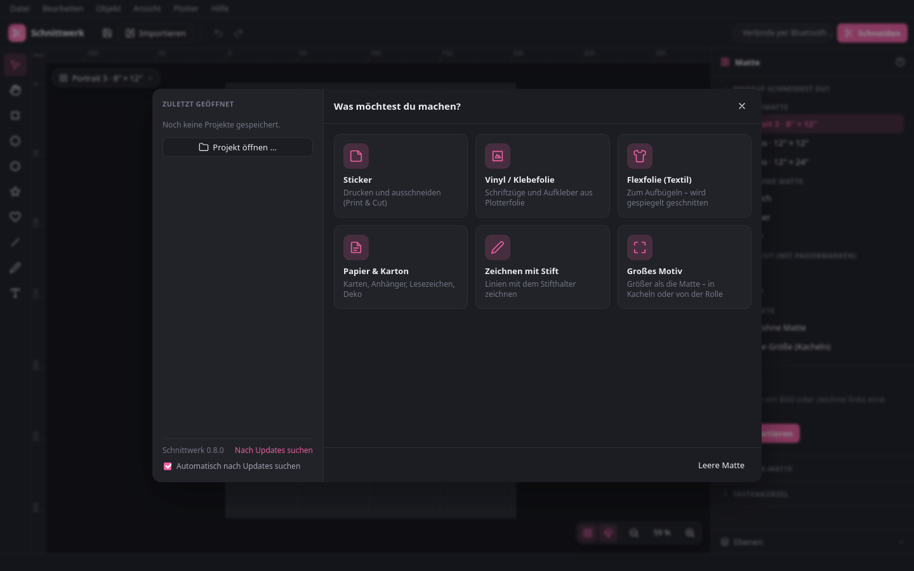
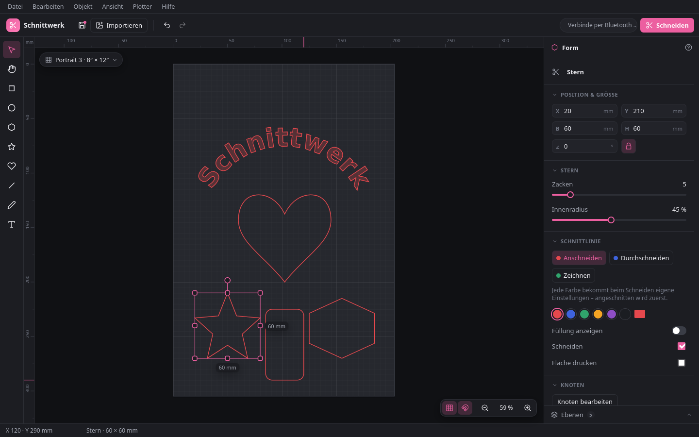
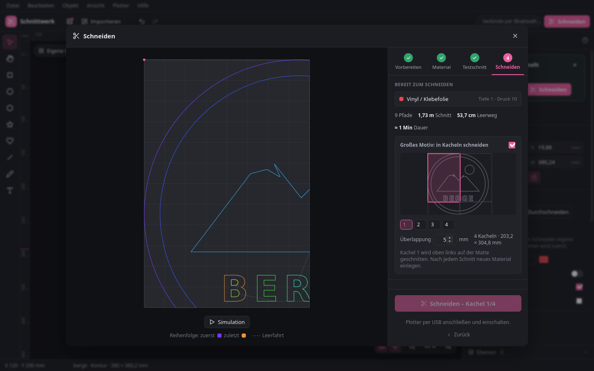

# Schnittwerk

Linux-Software für Silhouette-Schneideplotter (Ziel: **Portrait 3**). Damit kannst du
Bilder tracen, Sticker mit Print & Cut erstellen und direkt per USB schneiden. Du
brauchst dafür weder Silhouette Studio noch Windows.


> [!NOTE]
> **Von einer KI geschrieben.** Der Code und diese Anleitung wurden mit
> Claude (Anthropic) erstellt, unter Anleitung und mit Tests durch einen Menschen.
> Der Code wurde nicht unabhängig geprüft. Wer ihn für Wichtiges einsetzt, sollte
> ihn vorher selbst lesen.

> [!WARNING]
> Getestet ist bisher nur die **Portrait 3 (USB und Bluetooth)**. Die anderen
> Modelle sind eingebaut, aber noch nicht an echter Hardware erprobt
> (siehe [Unterstützte Geräte](#unterstützte-geräte)). Mach bei
> neuem Material immer erst einen Testschnitt. Die Nutzung erfolgt auf eigene
> Verantwortung (siehe [Lizenz](#lizenz)).

| Startseite | Bilder tracen | Sticker-Assistent |
|---|---|---|
|  |  |  |

| Formen, Text auf Bogen, Hilfslinien | Schneiden | Große Motive in Kacheln |
|---|---|---|
|  |  |  |

## Unterstützte Geräte

| Gerät | Eingebaut | USB | Bluetooth | An echter Hardware getestet |
|---|---|---|---|---|
| Silhouette Portrait 3 | ✅ | ✅ | ✅ | ✅ USB und Bluetooth |
| Silhouette Portrait 4 | ✅ | ✅ | ✅ | ⬜ noch nicht |
| Silhouette Cameo 4 | ✅ | ✅ | ✅ | ⬜ noch nicht |
| Silhouette Cameo 5 | ✅ | ✅ | ✅ | ⬜ noch nicht |
| Silhouette Portrait 2 | ⚠️ nur erkannt | – | – | ⬜ |
| Silhouette Portrait (1. Generation) | ⚠️ nur erkannt | – | – | ⬜ |

- **Eingebaut** heißt: Das Gerät wird erkannt und bekommt dieselben Befehle wie die
  Portrait 3 (Cameo-4-Gerätefamilie). Es sollte also funktionieren, ist aber nicht
  erprobt. Bei Bluetooth gilt das nur, wenn das Gerät Bluetooth hat.
- **Nur erkannt**: Ältere Modelle nutzen andere Befehle. Schnittwerk meldet sie,
  schneidet aber (noch) nicht mit ihnen.
- **Cameo 4 und 5**: Die 12″ × 12″- und 12″ × 24″-Matten sind eingebaut, aber noch
  nicht an einer Cameo getestet.
- Andere Hersteller (Cricut, Brother usw.) werden nicht unterstützt.

Wer ein nicht getestetes Gerät hat: Rückmeldung als
[Issue](https://github.com/FelixLenz-Code/schnittwerk/issues) hilft sehr,
gerne mit dem Ergebnis eines Testschnitts.

## Installation

### Ubuntu (ein Befehl)

Für **Ubuntu 24.04 oder neuer** und darauf aufbauende Systeme (64 Bit, x86):

```bash
wget -O /tmp/schnittwerk.deb https://github.com/FelixLenz-Code/schnittwerk/releases/latest/download/Schnittwerk_amd64.deb && sudo apt install -y /tmp/schnittwerk.deb
```

Der Befehl lädt das neueste `.deb` aus den
[Releases](https://github.com/FelixLenz-Code/schnittwerk/releases/latest) und installiert es.
`apt` installiert dabei die benötigten Pakete mit (libusb, CUPS-Client, poppler-utils).
Ein Hinweis von apt wie „Download is performed unsandboxed as root“ ist harmlos.

Danach:
1. **Stecke den Plotter einmal aus und wieder ein.** Das Paket bringt eine udev-Regel
   mit, damit Schnittwerk ohne Administratorrechte auf den Plotter zugreifen darf.
   Diese Regel greift erst nach dem Neueinstecken.
2. Starte **Schnittwerk** über das Anwendungsmenü.

Updates bietet Schnittwerk selbst an (siehe [Updates](#updates)), alternativ denselben Befehl
noch einmal ausführen. Zum Entfernen: `sudo apt remove schnittwerk`.

Lieber von Hand: `Schnittwerk_…_amd64.deb` aus dem neuesten Release herunterladen und im
Download-Ordner `sudo apt install ./Schnittwerk_*_amd64.deb` ausführen.

### Flatpak

Für andere Distributionen (Fedora, Arch, openSUSE …) gibt es ein Flatpak. Voraussetzung ist
nur, dass Flatpak installiert ist. Ein Befehl richtet bei Bedarf Flathub ein (von dort kommt
die GNOME-Laufzeit), lädt das neueste Schnittwerk-Flatpak und installiert es für deinen Benutzer:

```bash
flatpak remote-add --user --if-not-exists flathub https://dl.flathub.org/repo/flathub.flatpakrepo && curl -fL -o /tmp/Schnittwerk.flatpak https://github.com/FelixLenz-Code/schnittwerk/releases/latest/download/Schnittwerk.flatpak && flatpak install --user -y /tmp/Schnittwerk.flatpak
```

Ein Flatpak darf keine udev-Regel installieren. Damit der Plotter **per USB** erkannt wird,
einmalig die Regel auf dem System einrichten und den Plotter neu einstecken:

```bash
sudo wget -O /etc/udev/rules.d/70-silhouette.rules https://raw.githubusercontent.com/FelixLenz-Code/schnittwerk/main/packaging/70-silhouette.rules && sudo udevadm control --reload-rules
```

Gut zu wissen:
- Das Flatpak darf auf USB-Geräte, Bluetooth, den Home-Ordner und das Netzwerk (Update-Suche) zugreifen.
  PDF-Import (`pdftocairo`) und Drucken (`lp`) laufen über die Programme des Systems
  (Pakete `poppler-utils` und `cups-client` bzw. `poppler` und `cups`).
- Updates bietet Schnittwerk selbst an (siehe [Updates](#updates)).
  Entfernen: `flatpak uninstall --user de.schnittwerk.Schnittwerk`.
- Kommandozeile und MCP-Server sind enthalten:
  `flatpak run --command=schnittwerk-cli de.schnittwerk.Schnittwerk --help`.

### Updates

Schnittwerk fragt beim Start (höchstens alle 6 Stunden) bei GitHub nach, ob es eine neue
Version gibt. Wenn ja, erscheint oben der Knopf **Update** mit den Änderungen. Ein Klick auf
„Jetzt aktualisieren“ lädt das passende Paket, prüft die Prüfsumme und installiert es –
beim `.deb` mit der normalen Passwortabfrage des Systems, beim Flatpak ohne. Danach startet
Schnittwerk neu (ungespeicherte Änderungen werden vorher abgefragt).

Auf der Startseite (Klick auf „Schnittwerk“ oben links) steht die installierte Version,
dort lässt sich von Hand suchen oder die automatische Suche abschalten. Bei der Suche
wird nur die öffentliche Release-Liste von GitHub abgerufen.

## Funktionen

### Arbeitsfläche
- Assistent für neue Projekte: Sticker, Vinyl, Flexfolie, Papier & Karton, Stift oder großes Motiv –
  wählt Material, Matte oder Rolle, Druckseite und passende Vorlage; zeigt zuletzt geöffnete Projekte.
  Ein Klick auf „Schnittwerk“ oben links führt jederzeit zurück zu dieser Startseite.
  Importierte Bilder öffnen je nach Projektart den Sticker-Assistenten oder das Tracen
- Rechte Seite folgt der Auswahl: ohne Auswahl Matte und Werkzeuge für den ganzen Bogen, bei Bildern
  zwei Wege (in Schnittlinien umwandeln oder Sticker), danach Vorschläge für den nächsten Schritt;
  Ebenen einklappbar darunter
- Matte, Papier, Print & Cut, Rolle oder eigene Größe über einen Schalter oben links auf der Arbeitsfläche
- Automatisches Speichern einer Sicherheitskopie; nach einem Absturz wird die Arbeit beim Start angeboten
- Beim Schließen mit ungespeicherten Änderungen: Speichern, Nicht speichern oder Abbrechen
- Oberfläche auf Deutsch, Englisch, Französisch, Spanisch oder Niederländisch (folgt dem System, umschaltbar unter Datei → Einstellungen)
- Menüleiste (Datei, Bearbeiten, Objekt, Ansicht, Plotter, Hilfe) mit Tastaturbedienung und Einstellungen-Dialog
- Kurze Einführung beim ersten Start und ein Hilfe-Tab mit durchsuchbarer Anleitung (in allen fünf Sprachen)
- Rechtsklick-Menü auf Objekten und der Arbeitsfläche; einklappbare Bereiche in der Seitenleiste
- Matten für Portrait 3 (8″ × 12″) und Cameo (12″ × 12″, 12″ × 24″), A4 und Letter, Rolle ohne Matte (Länge einstellbar) und eigene Größe
  für große Motive – mit Raster und Linealen
- Hilfslinien aus den Linealen ziehen; Einrasten an Hilfslinien, Matte und anderen Objekten
- Raster beim Verschieben (0,5–10 mm) und Winkelschritte beim Drehen (1–90°), standardmäßig an
- Maße direkt am Objekt anzeigen und per Klick eingeben
- Zoom am Mauszeiger, Verschieben mit Hand-Werkzeug, Leertaste oder mittlerer Maustaste;
  Zoom in Prozent eintippbar, Originalgröße 1:1 mit Kalibrierung per Bankkarte (je Bildschirm,
  Hinweis bei nicht kalibrierten Bildschirmen)
- Auswählen, Rahmenauswahl, Verschieben, Skalieren, Drehen, Spiegeln
- Ausrichten, gleichmäßig verteilen, Anordnen, Gruppieren, Duplizieren, Sperren, Ein-/Ausblenden, Ebenenliste
  (umbenennen per Doppelklick oder F2, Reihenfolge per Ziehen, Rechtsklick-Menü, Mini-Vorschau, Gruppen aufklappbar)
- Mehrere Objekte gemeinsam bearbeiten: Position der Auswahl, Größe und Drehung jedes Objekts
- Rückgängig/Wiederholen mit Namen des Schritts, helles und dunkles Design (folgt dem System)
- Formen: Rechteck (mit Eckenradius), Ellipse, Vieleck, Stern, Herz, Linie, Freihand
- Text mit Systemschriften (fett/kursiv, Abstand, mehrzeilig, Verschweißen), auf einem Bogen oder entlang eines Pfads
- Boolesche Operationen: Vereinen, Abziehen, Schnittmenge, Ausschließen
- Knotenbearbeitung: Knoten und Griffe ziehen, einfügen, löschen, Ecke/Glatt, Gerade/Kurve
- Pfad vereinfachen: weniger Knoten bei gleicher Form
- Konturversatz nach innen oder außen
- Vorlagen: Sticker/Etiketten, Klappkarte, Lesezeichen, Geschenkanhänger

### Import und Export
- Bilder: PNG, JPG, WebP, BMP, GIF, TIFF
- Vektoren: SVG, PDF (Vektoren 1:1, Scans als Bild), DXF (Linien, Bögen, Kreise, Splines, Blöcke)
- Drag & Drop und Einfügen aus der Zwischenablage, auch aus anderen Programmen
- Projektdateien (`.schnitt`, Bilder eingebettet), SVG-Export der Schnittlinien

### Tracen
- Live-Vorschau beim Verstellen der Regler
- Modi: Schwarz/Weiß (automatischer Schwellwert), Farbe per Pipette,
  Mehrfarbig (eine Ebene je Farbe), Freistellen, Mittellinie (eine Linie durch jeden Strich)
- Helligkeit, Kontrast, Weichzeichnen, Glättung, Flecken entfernen, Dicker/Dünner, nur Außenkontur
- Radierer und Pinsel zum Bereinigen vor dem Tracen
- Fotos von Zeichnungen: Perspektive korrigieren (Blatt wird erkannt) und Beleuchtung ausgleichen

### Schneiden
- USB und Bluetooth LE (mit automatischem Wiederverbinden)
- Materialbibliothek mit Vorlagen und eigenen Profilen: Messertiefe (AutoBlade), Druck,
  Geschwindigkeit, Durchgänge, Überschnitt; eigene Materialien unter Plotter → Materialien,
  Material des Projekts neben dem Schneiden-Knopf, gute Testwerte direkt als Material speichern
- Optimierte Reihenfolge: innen vor außen, kurze Leerfahrten
- Vorschau der Schnittreihenfolge mit animierter Simulation, Fortschritt, Pause und Abbrechen
- Benachrichtigung und Ton, wenn ein Schnitt fertig ist
- Geschätzte Schnittzeit vorher und Restzeit während des Schnitts (lernt mit jedem fertigen Schnitt dazu)
- Nach einem Abbruch oder Verbindungsfehler an der unterbrochenen Stelle weiterschneiden
- Material je Schnittfarbe: Anschneiden (Kiss-Cut) und Durchschneiden in einem Auftrag
- Geführter Ablauf in vier Schritten: Vorbereiten, Material, Testschnitt, Schneiden
- Testschnitt an einer frei gewählten Stelle (Klick in die Vorschau, warnt bei Überschneidung mit dem Motiv);
  danach fragt Schnittwerk nach dem Ergebnis und passt Tiefe oder Druck an
- Testreihe als Raster aus Messertiefe × Druck mit Vorschlägen je Material (bestes Quadrat anklicken), Stiftmodus, Spiegeln für Flexfolie – ganze Folie oder jedes Element an seiner eigenen Mittelachse
- Große Motive in Kacheln schneiden (Überlappung einstellbar, Kachelkarte, erledigte Kacheln werden markiert)
- Schneiden ohne Matte von der Rolle; Folie wird am Ende hinter das Motiv geschoben
- Messerverschleiß-Zähler mit Erinnerung nach einstellbarer Schnittstrecke
- Entgitterungshilfen: Rahmen und Linien durch den Abfall
- Nesting: Formen platzsparend verschachteln und drehen

### Print & Cut und Sticker
- Sticker-Assistent: Hintergrund entfernen oder Transparenz nutzen, Rand in mm, glatte Kontur
- Einzelsticker: anschneiden (abziehbar) und mit Trägerrand durchschneiden
- Sticker-Bogen in einem Rutsch: mehrere Bilder auswählen – Konturen, Exemplare und platzsparende Anordnung auf einmal
- Print-&-Cut-Seite (A4/Letter) mit Silhouette-Passermarken; der optische Sensor findet sie automatisch
- Bogen füllen, Rand farbig drucken, Bleed (Motivfarben über die Schnittlinie hinaus)
- Drucken über CUPS ohne Skalierung oder als PDF speichern, danach direkt weiter zum Schneiden
- Feinjustierung Druck ↔ Schnitt mit Testbogen
- PixScan-Matte: Foto der Matte wird erkannt, entzerrt und in Originalgröße an die Schneideposition gelegt

### Kommandozeile und KI-Assistenten
- `schnittwerk-cli`: Bilder tracen, SVG/DXF/Projekte schneiden, ohne Oberfläche
- `schnittwerk-mcp`: MCP-Server, über den KI-Assistenten wie Claude tracen,
  Sticker-Bögen anlegen und (nur mit Bestätigung) schneiden können

Stand und Pläne: [ROADMAP.md](ROADMAP.md).

## So geht's: Sticker drucken und schneiden

1. Bild importieren (`Strg+I`) oder hineinziehen.
2. Oben links auf der Arbeitsfläche **Print & Cut** wählen.
3. Rechts **Als Sticker** wählen, Rand und Freistellen einstellen, **Kontur übernehmen**.
4. Im Vorschlag danach **Bogen füllen** – der Bogen wird mit Kopien gefüllt.
5. **Drucken** (`Strg+P`), das Blatt auf die Matte legen und einlegen.
6. **Schneiden** (`Strg+Enter`): Der Dialog führt durch Material und Testschnitt
   (Stelle in der Vorschau anklicken) bis zum Schnitt. Die Passermarken werden automatisch gesucht.

## Kommandozeile

```bash
schnittwerk-cli trace zeichnung.jpg --flatten --width 120   # → zeichnung.svg
schnittwerk-cli cut logo.svg --material vinyl --dry-run     # nur Vorschau
schnittwerk-cli cut bogen.schnitt                            # Projekt, Material je Schnittfarbe, Rückfrage
schnittwerk-cli cut bogen.schnitt --material '#e5484d=sticker-glossy' --yes
schnittwerk-cli scan && schnittwerk-cli status --ble ID      # Bluetooth
```

Alle Optionen: `schnittwerk-cli --help`.

## MCP-Schnittstelle (KI-Assistenten)

`schnittwerk-mcp` ist ein MCP-Server (stdio). Damit können KI-Assistenten wie
Claude Bilder tracen, Sticker-Bögen als `.schnitt`-Projekt anlegen und SVGs
schneiden. Geschnitten wird nur mit ausdrücklicher Bestätigung (`confirm`).

```bash
# nach Installation des .deb
claude mcp add schnittwerk -- /usr/bin/schnittwerk-mcp
# aus dem Quellcode
cargo build --release -p schnittwerk-mcp
claude mcp add schnittwerk -- "$PWD/target/release/schnittwerk-mcp"
```

Werkzeuge: `plotter_status`, `list_materials`, `trace_image`, `sticker_sheet`, `cut_svg`.

## Tastenkürzel

| Taste | Funktion |
|---|---|
| `V` / `H` / `T` | Auswahl / Ansicht verschieben / Text |
| `R` / `E` / `P` / `S` / `L` / `F` | Rechteck / Ellipse / Vieleck / Stern / Linie / Freihand (Shift = unverzerrt bzw. 15°) |
| `Alt` beim Ziehen | Einrasten (Raster, Hilfslinien, Winkel) kurz ausschalten |
| Lineal ziehen / Rechtsklick auf Hilfslinie | Hilfslinie anlegen / löschen (oder zurück aufs Lineal ziehen) |
| `Leertaste` + Ziehen, mittlere Maustaste | Ansicht verschieben |
| Mausrad | Zoom (Shift = horizontal scrollen) |
| `Strg+0` / `Strg+2` | Matte einpassen / Auswahl einpassen |
| `Strg+1` | Originalgröße 1:1 (Bildschirm unter Ansicht → Bildschirm kalibrieren) |
| Rechtsklick | Menü mit den häufigsten Aktionen |
| `Alt`+Buchstabe / `F1` / `Strg+Q` | Menü öffnen / Hilfe / Beenden |
| `Strg+I` / `Strg+E` | Importieren / SVG exportieren |
| `Strg+Enter` / `Strg+P` | Schneiden-Dialog / Drucken |
| `Strg+G` / `Strg+Shift+G` | Gruppieren / Gruppierung lösen |
| `Strg+N` / `Strg+Shift+N` | Neues Projekt (Assistent) / Neu aus Vorlage |
| `Strg+S` / `Strg+Shift+S` / `Strg+O` | Speichern / Speichern unter / Öffnen |
| `Strg+Z` / `Strg+Y` | Rückgängig / Wiederholen |
| `Strg+D` / `Entf` | Duplizieren / Löschen |
| `Strg+C` / `Strg+X` / `Strg+V` | Kopieren / Ausschneiden / Einfügen (auch Bilder und SVG aus anderen Programmen) |
| Pfeiltasten (+Shift / +Alt) | 1 mm (10 mm / 0,1 mm) verschieben |
| Ecke ziehen (+Shift) | proportional (frei) skalieren |
| Drehgriff (+Shift) | drehen (in 15°-Schritten) |

## Aus dem Quellcode bauen

Rust (Kern + Backend) · Tauri 2 · Svelte 5 + TypeScript (Oberfläche)

```bash
# Systempakete für Tauri + USB
sudo apt install pkg-config libwebkit2gtk-4.1-dev libgtk-3-dev libdbus-1-dev \
  librsvg2-dev libayatana-appindicator3-dev libxdo-dev libusb-1.0-0-dev poppler-utils

# Rust (falls nicht vorhanden)
curl --proto '=https' --tlsv1.2 -sSf https://sh.rustup.rs | sh

npm install

# Zugriff auf den Plotter ohne root (einmalig)
sudo cp packaging/70-silhouette.rules /etc/udev/rules.d/
sudo udevadm control --reload-rules && sudo udevadm trigger
```

```bash
npm run tauri dev      # Entwicklungsmodus mit Hot-Reload
./scripts/build-deb.sh # .deb mit hochgezählter Version unter target/release/bundle/deb/
cargo test -p schnittwerk-core
python3 scripts/i18n-keys.py          # fehlende Übersetzungen
python3 scripts/screenshots.py        # README-Screenshots neu erzeugen (X11, --build baut vorher)
cargo clean --profile dev             # alte Debug-Builds löschen (wachsen sonst stark an)
```

Hardware-Test ohne Oberfläche: `cargo run -p schnittwerk-plotter --example status`

Releases baut GitHub Actions: Ein Tag `vX.Y.Z` (passend zur Version in `Cargo.toml`)
erzeugt das .deb und hängt es an ein neues Release.

### Aufbau

```
crates/schnittwerk-core/   Rust-Bibliothek ohne GUI
  src/trace.rs             Tracing-Pipeline (Masken → Konturen → Bézier)
  src/preprocess.rs        Helligkeit/Kontrast, Otsu, Farbmasken, k-means
  src/svg_import.rs        SVG → ein zusammengesetzter Pfad in mm
  src/cut.rs               Pfade → Schnittreihenfolge, Überschnitt, Durchgänge, Kachel-Zuschnitt
  src/simplify.rs          Pfade vereinfachen (Ecken behalten, Kurven neu anpassen)
  src/text.rs              Text → Konturen, auch entlang eines Pfads
  src/gpgl.rs              GPGL-Befehle (Silhouette/Graphtec-Protokoll), Passermarken
  src/offset.rs            Distanztransformation, Konturversatz (Bilder + Vektoren)
  src/sticker.rs           Sticker-Kontur: Motiv freistellen, Rand, Löcher füllen
  src/photo.rs             Fotos: Perspektivkorrektur (Blatt erkennen, entzerren), Beleuchtungsausgleich
crates/schnittwerk-plotter/ USB (rusb) und Bluetooth LE (btleplug): Status, Senden, Pause/Abbruch
crates/schnittwerk-mcp/    MCP-Server für KI-Assistenten
crates/schnittwerk-cli/    Kommandozeile (tracen, schneiden)
src-tauri/                 Tauri-Backend (Befehle, Bildspeicher, Schneide-Thread, PDF/Druck)
src/                       Oberfläche
  lib/editor.svelte.ts     Dokument-Zustand, Auswahl, Undo/Redo
  lib/io.svelte.ts         Import, Projektdateien (.schnitt), Autosave, zuletzt geöffnet, SVG-Export
  lib/shapes.ts            Formen (Vieleck, Stern, Herz, Freihand …)
  lib/components/          Canvas, Trace-Panel, Eigenschaften, Ebenen …
```

## Lizenz

Schnittwerk ist freie Software unter der [GNU GPL v3 oder neuer](LICENSE).
Es gibt keine Gewährleistung und keine Haftung (Abschnitte 15 und 16 der GPL).
Fremdbestandteile (Icons, Bibliotheken) und ihre Lizenzen: [THIRD_PARTY.md](THIRD_PARTY.md).

Schnittwerk ist ein unabhängiges Projekt und steht in keiner Verbindung zu
Silhouette America, Inc. oder Graphtec. „Silhouette“, „Portrait“, „Cameo“,
„PixScan“ und „AutoBlade“ sind Marken ihrer jeweiligen Inhaber und werden hier
nur verwendet, um die unterstützte Hardware zu benennen.
